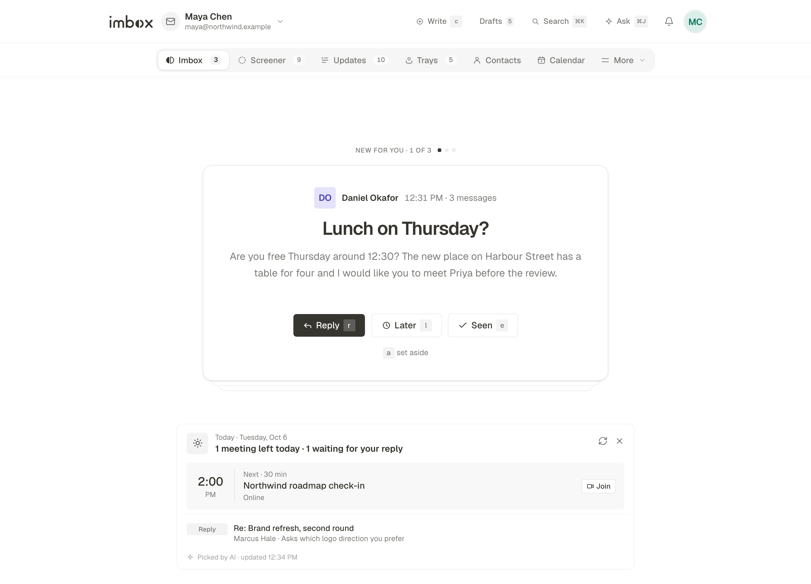

# Imbox

A calm email client for mail you host yourself.

Imbox reads your Gmail, your Outlook and any other mailbox, and puts all of it behind one quiet screen. New senders wait in the Screener for your yes or no before they reach you. People come first, and newsletters and receipts stay out of the way. An optional AI assistant helps when you ask it, and never sends anything without you.

It runs on your own server, has one owner, and has a separate layout for phones.

## See it

The Imbox, where mail from people lands, with what is waiting for your reply at the top:

## Status

The first release, **0.1.0**, is planned for **1 November 2026**. The source code, the Docker image and the release notes will be published here on that day. Until then this page is all there is.

Watch the repository (Watch, then Custom, then Releases) to be told when it ships.

## Links

- Website: [imbox.lol](https://imbox.lol)
- Documentation: [imbox.lol/docs](https://imbox.lol/docs)
- Read the letter: [LETTER.md](LETTER.md), or on the website at [imbox.lol/letter](https://imbox.lol/letter)

## License

[MIT](LICENSE)
